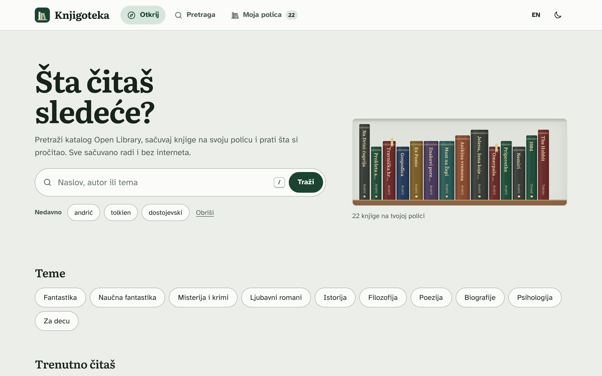
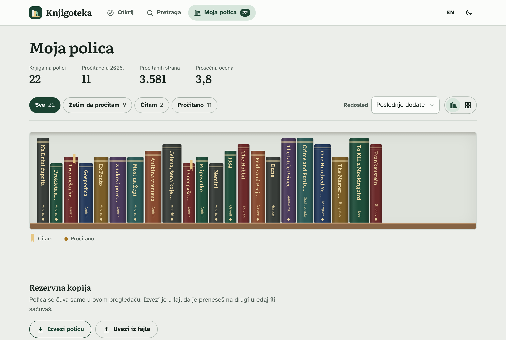
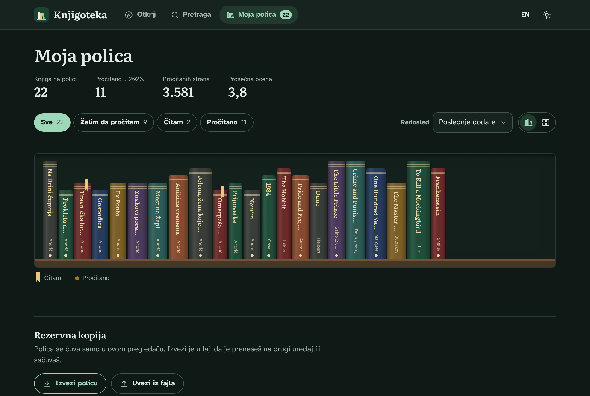
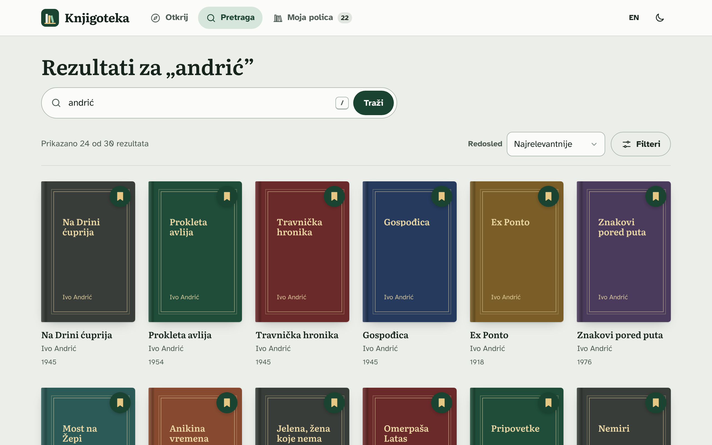
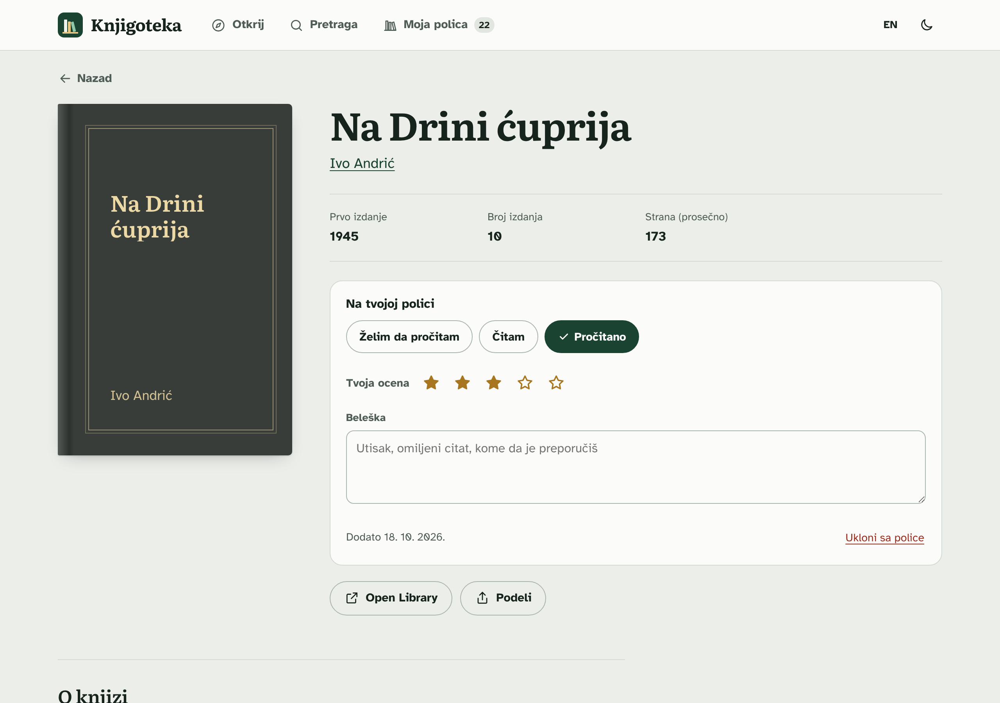
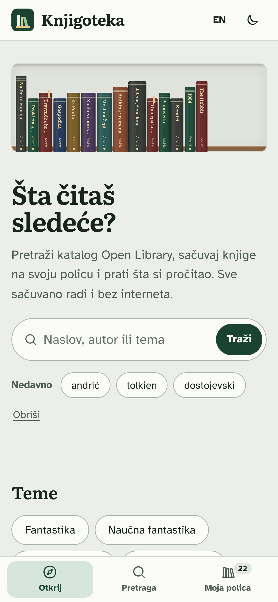

# Knjigoteka

**An offline-first Progressive Web App for finding books and keeping a personal reading shelf.**
Search the [Open Library](https://openlibrary.org) catalogue, save books as *want to read*, *reading* or *read*, rate them, write notes, and browse your collection as a real bookcase. Everything you save works without an internet connection, and the app installs on desktop and phone like a native app.

**[Open the live app](https://vojvodixdev.github.io/knjigoteka/)** &nbsp;·&nbsp; Serbian & English UI &nbsp;·&nbsp; No framework, no build step

<p>
  
</p>

| Shelf (light) | Shelf (dark) |
|---|---|
|  |  |

| Search | Book page | Mobile |
|---|---|---|
|  |  |  |

---

## Features

**Finding books**
- Full-text search with sorting (relevance, rating, number of editions, newest, oldest)
- Filters for edition language, year of first publication and "readable online", shown as removable chips
- "Show more" pagination, skeleton loading states and clear empty / error / offline states
- Topics on the home page and today's trending books
- Recent searches; press <kbd>/</kbd> anywhere to jump to search

**Your shelf**
- Three statuses, a 1–5 star rating and a private note per book (autosaved)
- **Bookcase view**: every saved book is drawn as a spine; height is stable per book, thickness follows its page count, a ribbon marks what you're reading
- Grid view, status tabs, sorting by date, title, author or rating
- Reading stats: books on shelf, read this year, pages read, average rating
- Export to / import from a JSON backup (merges by most recent change)
- Undo for every add and remove

**Book page**
- Description and subjects from the Works API, community rating, editions, page count
- Author and subject links start a new search
- Share via the Web Share API (or copy link); "Read for free / Borrow" link when Open Library has an e-book

**App quality**
- Installable PWA with maskable icons, app shortcuts and install screenshots
- Works offline: app shell precached, API responses network-first with a timeout, covers cache-first with a size cap
- "New version available – Reload" prompt instead of silently swapping code under the user
- Every screen has a shareable URL (hash router); back button and scroll position behave as expected
- Light and dark themes (follows the system, can be overridden), Serbian and English with proper plural rules
- Accessible: semantic landmarks, skip link, focus management on navigation, `aria-live` announcements, visible focus, reduced-motion support; automated axe checks pass on every screen
- Strict Content-Security-Policy (no inline scripts or styles), all API data escaped before rendering
- Self-hosted fonts, no third-party trackers, ~650 KB total including fonts and icons

## Architecture

```
app/
├── index.html          shell: header, navigation, icon sprite, <main id="view">
├── sw.js               service worker (caching strategies, update flow)
├── manifest.webmanifest
├── css/app.css         design tokens, light/dark themes, components
└── js/
    ├── app.js          entry: wires store, API, router and views; global events
    ├── api.js          Open Library client: URL building, response normalisation, in-memory cache
    ├── store.js        shelf + settings in localStorage, migration, import/export
    ├── router.js       hash routes <-> state (search filters live in the URL)
    ├── i18n.js         Serbian/English strings, Intl.PluralRules
    ├── ui.js           covers, cards, spines, toasts (HTML templates, escaped)
    ├── pwa.js          SW registration, update prompt, install button, offline bar
    ├── util.js         pure helpers
    └── views/          home, search, book, shelf – each returns { update, onAction, destroy }
```

Plain ES modules, no framework and no bundler: the `app/` folder is deployed as-is.
Views are functions that render into `<main>`; a single delegated click handler routes `data-action` buttons to the active view. The pure modules (`api`, `store`, `router`, `i18n`, `util`) have no DOM dependencies, which is what makes them unit-testable in Node.

### Caching strategy

| Request | Strategy | Reason |
|---|---|---|
| App files (HTML, CSS, JS, fonts, icons) | Precache on install, cache-first | Change only with a release; versioned cache name |
| `search.json`, `works/*.json`, `trending/*` | Network-first, 7 s timeout, fallback to cache, capped at 150 entries | Fresh results online, last known results offline |
| Cover images | Cache-first, capped at 400 entries | Covers never change; the cap keeps storage bounded |
| Nothing cached and offline | Service worker answers `503 { "offline": true }` | The app shows an "offline" state instead of a generic error |

If a cover can't load (offline, missing), the UI shows a generated cloth-bound cover with the title, so the grid never shows broken images.

### Data model

Shelf entries keep a normalised copy of the book (so the shelf works offline) plus `status`, `myRating`, `note`, `addedAt`, `updatedAt`, `finishedAt`. The first version of the app (my bachelor thesis) stored a plain list under another key; it is migrated automatically on first load.

## Running locally

Requires Node 20+ (only for the dev server and tests – the app itself has no dependencies).

```bash
npm install          # test tooling only
npm start            # http://localhost:8080
```

A service worker needs `http://localhost` or HTTPS, so opening `index.html` directly from disk won't work. Any static server pointed at `app/` is fine (e.g. VS Code Live Server).

## Tests

```bash
npm test             # 40 unit tests (node:test) – API URLs and parsing, store, router, i18n
npx playwright install chromium
npm run test:e2e     # 34 end-to-end tests on desktop and mobile viewports
```

End-to-end tests mock Open Library with fixtures, so they are fast and deterministic. They cover search, pagination, sorting and filters, saving and undo, the book page (status, rating, autosaved note surviving a reload), shared deep links, shelf tabs and views, export/import, language and theme persistence, the keyboard shortcut, axe accessibility checks on every screen, the manifest, and a real offline run with the service worker.

## Deployment

The GitHub Actions workflow in `.github/workflows/ci.yml` runs all tests and, on `main`, publishes `app/` to GitHub Pages at [vojvodixdev.github.io/knjigoteka](https://vojvodixdev.github.io/knjigoteka/). In the repository settings choose **Pages → Source: GitHub Actions**.

When releasing a change to app files, bump `VERSION` in `app/sw.js` so installed copies pick up the update.

## Credits

- Book data and covers: [Open Library](https://openlibrary.org) (Internet Archive)
- Fonts: [Literata](https://github.com/googlefonts/literata) and [Atkinson Hyperlegible](https://www.brailleinstitute.org/freefont/), SIL Open Font License
- Started as my bachelor thesis at the Faculty of Technical Sciences Čačak, University of Kragujevac (2026), then rebuilt as a portfolio project

---

## Ukratko na srpskom

Knjigoteka je progresivna web aplikacija za pretragu knjiga iz kataloga Open Library i vođenje lične police (želim da pročitam / čitam / pročitano, ocene, beleške, statistika čitanja). Radi bez interneta, instalira se na telefon i računar, ima svetli i tamni režim i interfejs na srpskom i engleskom. Napisana je bez frejmvorka, u čistom JavaScriptu (ES moduli), sa unit i end-to-end testovima i automatskim objavljivanjem na GitHub Pages.

## License

MIT © 2026 Nikola Vojvodić
